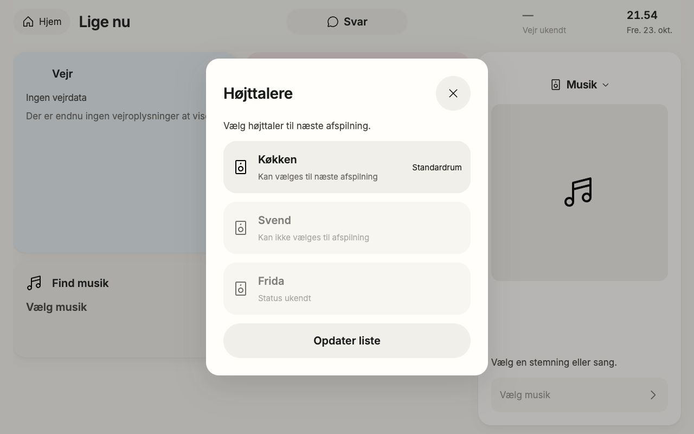
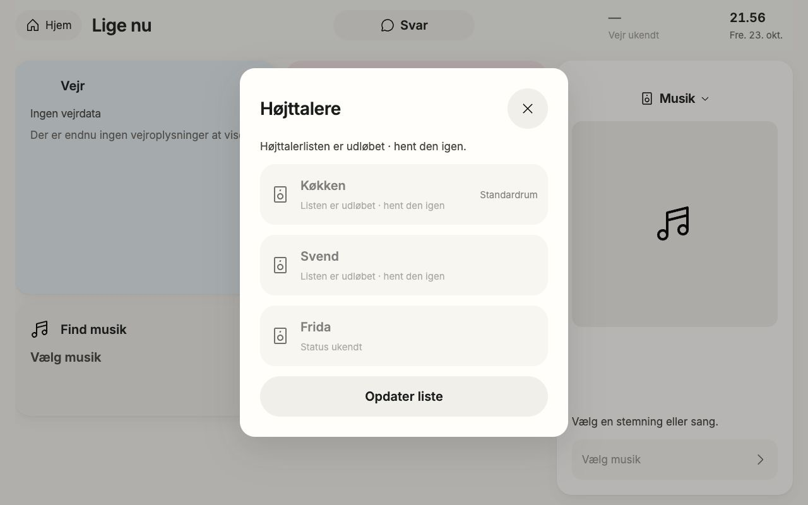
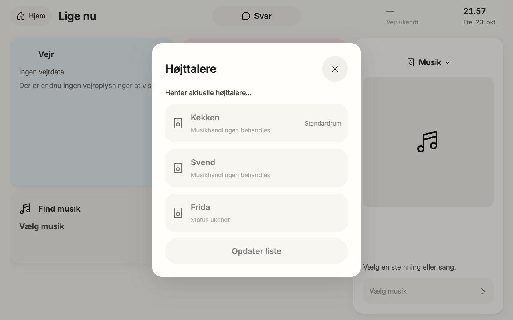
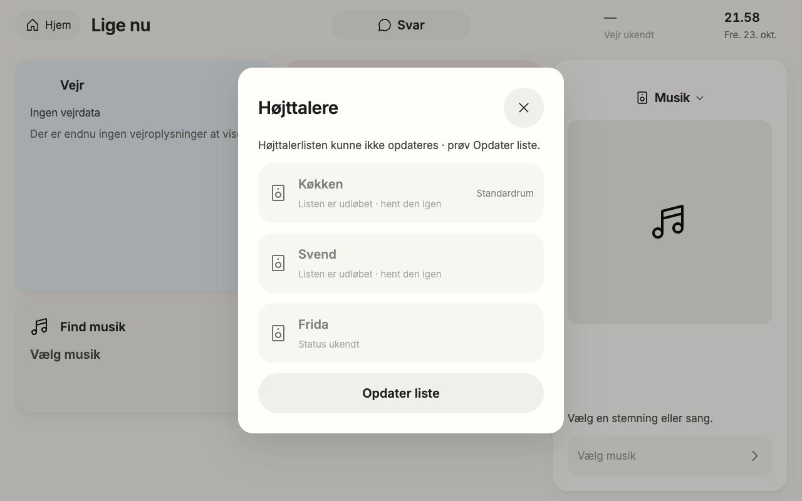
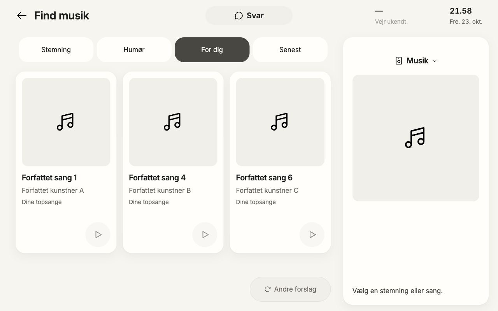
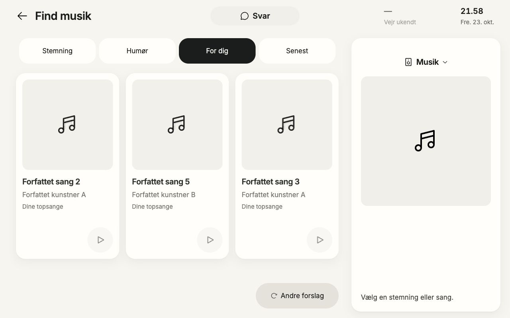
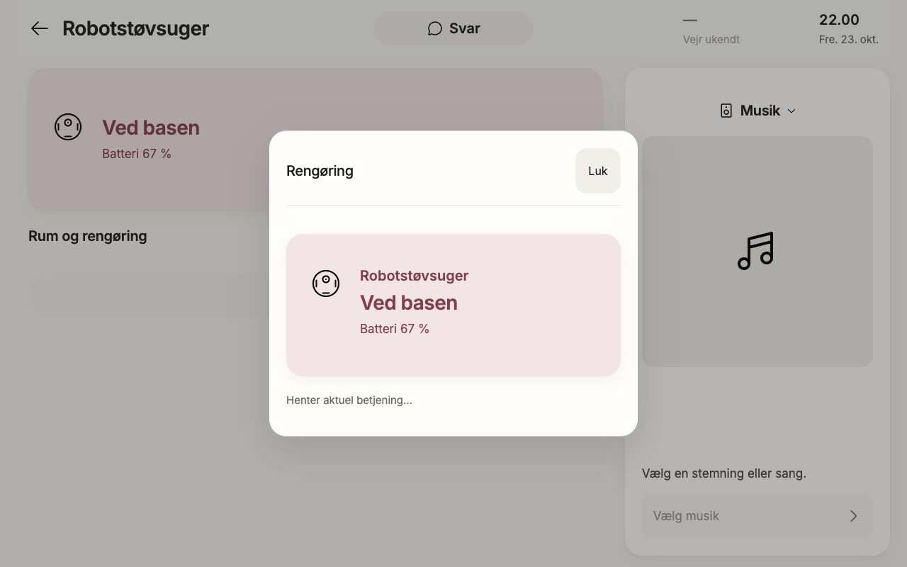
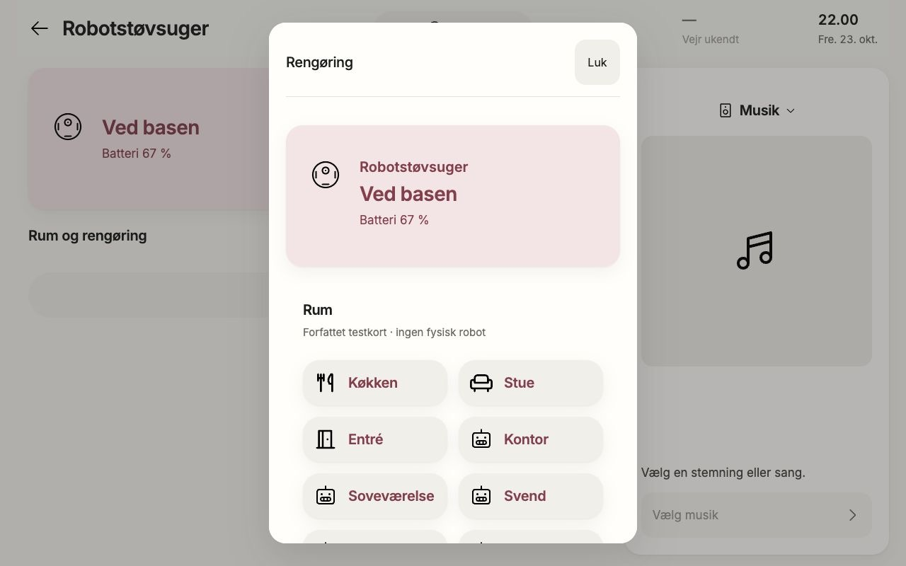
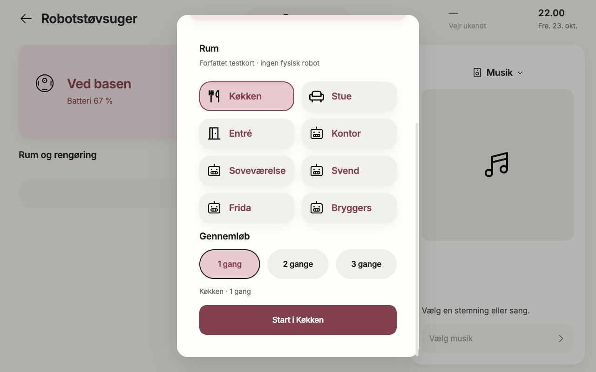
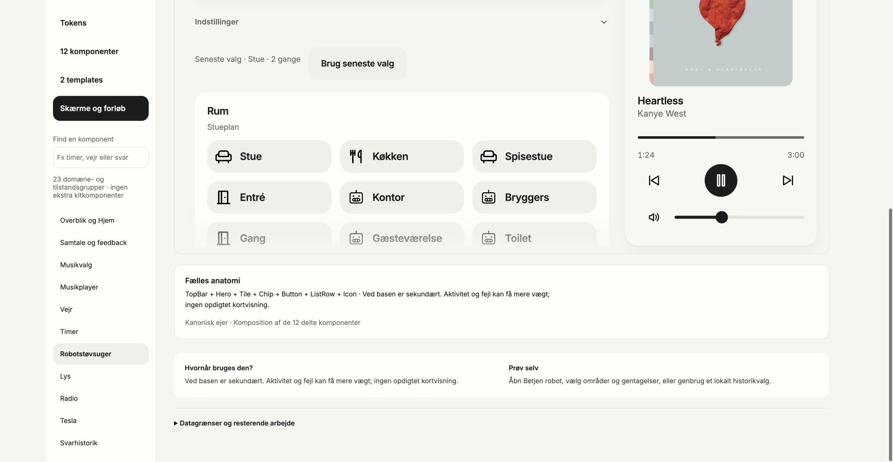

# Native speaker, robot and source-page browser proof

23 October2026. Local authored HTTP fixtures; no physical/provider acceptance. Source implementation: scripts/basic-flow-diagnostic.mjs, with6focused contract/wire tests passing, no network bind. Existing live-fixture route only. No product mock renderer; actual /view/ loads native WidgetHost/SpeakerOutputView/RobotControlPanel.

## Capture dimensions and scope

CUA inventory exposed only Chrome, so root authorized own new Chrome tabs without changing shared viewport. Actual browserouter2006×1038; test-only fixture-frame hosts1280×800 iframe at0,0. Product JPEGs clip that exact frame1280×800, not resize a larger product. Library screenshot is2006×1038 containing its authored1280preview scaled by library; it is explicitly not a native1280fullbrowser screenshot. No HA/user tabs touched.

## Speaker actual flows

Native photo→Lige nu→output opens whole-viewport modal520×584 at380,108 in1280frame. Three actual catalogue rows456×96: Køkken available/startSelectabletrue remains selectable and unpressed; Svend available/startSelectablefalse disabled with “Kan ikke vælges til afspilning”; Fridaunknown disabled with “Status ukendt”. No row was selected. Actual30second expiry observed while modal remained open: known rows retained disabled, no selected claim; explicit “Højttalerlisten er udløbet · hent den igen.” Refresh remains available. No clock manipulation.

Manual Opdater liste sends real local GET; existing rows remain in place disabled during3second read, then ready returns. basic-speakers-error read3 returns503; known three rows remain disabled with explicit “Højttalerlisten kunne ikke opdateres · prøv Opdater liste.” Explicit retry read4 recovers original truthful availability; no automatic action retry. Prior server68397 yielded expiry; final server3355 yielded error/recovery after fixture-only POSTrouting correction. Runtime speaker source unchanged between these observations.

Visually inspected ready/expired/pending/error images: consistent centered520modal, same row spacing, reserved feedback, no overlap or layout collapse. Disabled text visibly muted; no WCAG compliance claim. Pending row detail uses current generic “Musikhandlingen behandles” while top status correctly describes list fetch; this is presentation copy, no playback action.

## Readonly native top source spread

basic-top has actual local GET top with authored A,A,A,B,B,C artists plus repeatedURI. No selection/control capability. Native For dig shows song1A/4B/6C, Andre forslag shows2A/5B/3A. Six distinct source tracks appear before repeatURI; disabled cards still have readable titles/artists and honest missing artwork. Product Design/Impeccable visual inspection found stable card frames, square art reservation, unchanged playerempty and refresh geometry. This proves bounded source-page software ordering, not taste ranking, personal provider listening data or recommendation quality.

## Robot findings and pending after-proof

Actual native robot home observation67% docked→detail→Betjen robot invokes real POST control/setup, delayed3seconds. Fresh first-open retains robotHero and visible “Henter aktuel betjening…”; actual reply admits eight offered rooms and repeat1..3. No Start submitted; fixture rejects ALL action endpoints403.

Two concrete findings reported to root: close/reopen after failed setup updated detached panel and displayed blank pending modal; narrow520modal used3columns truncating even Køkken. Freshloading beforefix and settledbadgrid images are historical findings, not acceptance. Root implementing canonical fixes; final bounded after-proof required below.

Existing library Robotstøvsuger /9rum·2kort·indstillinger uses sameRobotControlPanel Hero, roomTile and repeatChip roles. Inspected library rooms screenshot; widercomposition3columns readable. It does not stand in for native narrowmodal state or real setup authority.

## Corrected robot final after-proof — PASS

Reloaded once after root final8e5e2bundle/4eceCSS build. Fresh open and actual same-target Close→Betjen robot reopen both mount the robotHero67%/Vedbasen plus “Henter aktuel betjening…” during real3second setup. No blank pending body. Reply renders eight offered rooms. Actual DOM measured TWOcolumns204×64 with16pxgap atx428/648, all full labels including Soveværelse. Scroll exposes all eight rooms, repeat1..3 and explicit Start. Selecting Køkken changes only draft/pressed state; Start i Køkken is enabled; it was NOT clicked. Close returns robotdetail, no cleaning command.

Product Design/Impeccable after-image assessment: modal overlay centered across full1280frame, mountedHero during loading, readable complete room names, consistent icon/type/control roles, two-column spacing, selectedTile/Chip distinct and footer accessible by native scroll. No row clipping after correction. Final wider existing library9room panel remains THREEcolumns with full short labels, preserving its shared anatomy and authoreddata. Library screenshot includes frameedge cropping/scroll viewport, not all9rows or a native1280pixel screenshot; it supports grid/anatomy comparison, not entireflow acceptance.

All product images are actualJPEG1280×800 clips of native1280×800iframe. Library images actualJPEG2006×1038 with library's scaled1280preview. Personally inspected saved images. Own two QA tabs closed, no browserviewport changed, root-owned4185server remains running. No HA/provider/audio/physicalactions. Final fulltest/sourcepacket evidence belongs to releaseowner, not inferred from these screenshots.

## Final source hashes

- `scripts/basic-flow-diagnostic.mjs` — `975274640458634d98ba20d9fbde979db05f0510d5760817c46cbe9781b16bbe`
- `scripts/live-fixture.mjs` — `c36b836f45c2eb9b2bb1d1abce50c2ac1b058b3ee5316070d1769326b8db2045`
- `tests/basic-flow-diagnostic.test.js` — `7286dafd00779ed386c0e804d6deee96dc2ae4551c3661f20f3ea9dd143a4f12`
- `dist/speaker-output-view.js` — `6a9db16020ca31c6280d29ba0473be5ff168deb02907466c903eabf335360e94`
- `dist/robot-control-panel.js` — `2de3f9fb6541b6a0c6b760568b43cb4c9d6cb0b8f3122654b7b57a92b1fff75c`
- `dist/live-control-view.js` — `0dbef613f9a0e8541ecf58ab1a4c87891a4f69dded5ff9527049c0b23fba29bb`
- `dist/ui/components.css` — `0ddb3cb8a4c42aabe230bb9e97c378c8f258cdb6fed0ec79e9cc2bf6800a291e`
- `dist/ui-kit.css` — `8831892647815dfd2d688c00c91d24c65bd58533b8de8fa087af81dc9ca68871`
- `dist/podview.bundle.js` — `8e5e2ea20ec507d8807d81d11fdd81defa6959b8d65bc5093cd8597b8c9748fe`
- `dist/podview.css` — `4ecec55d5825b53784586ed6491c995f92f08643d67fd6a5e9ffd93961f081a1`
