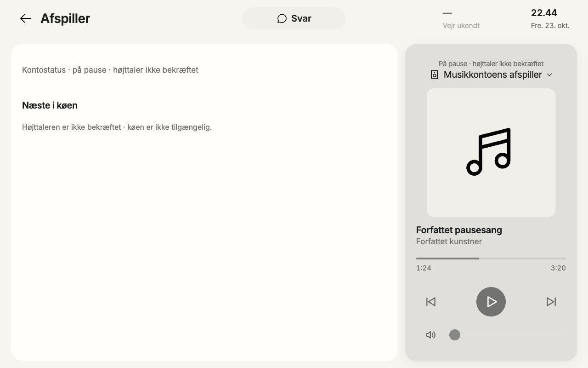
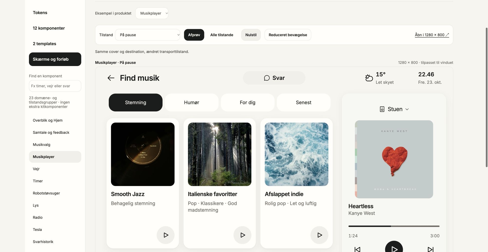
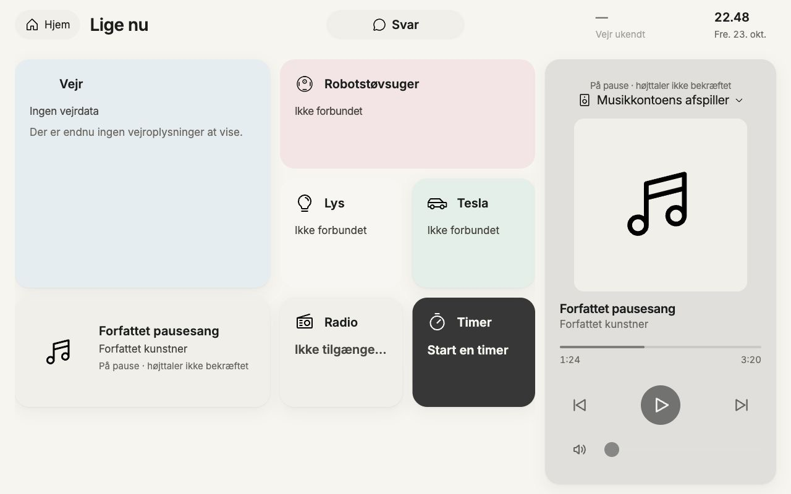

# Explicit account-observed paused player — local review

23 October2026. Authored nativeHTTP fixture /view/?room=account-observed-paused via1280×800iframeclip, no sharedviewport changes. Exactclosed8-key room-playback wrapper with nonnullsavedbindingdescriptor and statusaccount_observed; datacontainsfreshaccountplayback but NOroom_proof_valid_until. Actualparser admits custodyonly: readOnlytrue, roomBoundfalse. Twofocusedwire/parsertestsPASS; queue/effect endpoints403, timers.items=[] and nocontrol/queue/selectioncaps.

ActualUI shows Forfattetpausesang / Forfattetkunstner,1:24/3:20, neutralmissingart. Output explicitlyqualifies “Påpause·højttalerikkebekræftet / Musikkontoensafspiller”. Nativeplayerdetail opens normally and says “Kontostatus·påpause·højttalerikkebekræftet”; queue says “Højttalerenerikkebekræftet·køenerikketilgængelig.” Actualprev/play/next/volume disabled, seekabsent. No command/queue/audio. No savednative speaker label is presented as observedphysicaloutput.

Firstoverviewcapture incorrectlyused “Sidstkendteafspilning” for freshaccountcustody; rootowneracceptedconcretefinding and narrowpresentationfix. That historicalimage is not finalacceptance; freshafterproof appendedbelow.

Existinglibrary Musikplayer/Påpause compared canonicalcover/title/artist/progress/controlpositions. Its locallyauthoredHeartless/Stuen is an ordinaryexample withlocalcontrols, NOT account_observed/nativebindingacceptance. Savedreference is2006×1038outer scaled1280preview withsomefooteroutsideviewport; nativeproductclip provideswholeplayer. Visualinspectionconfirms sameanatomy; authoritydifferencesremainexplicit.

NoactualSpotify/account/provider/physicalroomrouting/installation claim. NoPlay,volume,seek,queue,timer,alarm or audio action.

## Final overview caption after-proof — PASS

After completed final2build (releaseowner1992/1992+gatePASS), cleanreload→actualaccountpausedread→Lige nu. Freshoverview now correctly says “Påpause·højttalerikkebekræftet”, keeps actualauthoredtitle/artist and does not claim staleaccountdata or confirmedphysicalroom. Savednative1280image personallyinspected: captionfits existingsecondaryrole, player andoverviewconsistent; allcommandsremaindisabled. Earlieroverviewimage is historical. No otherstates or effects rerun.

Final source and image SHA-256 binding: LATE-SILENT-REVIEW-METADATA.json. Screenshots personally inspected using Product Design and Impeccable review criteria; source/tests, local visual evidence, provider delivery and physical acceptance remain separate.
