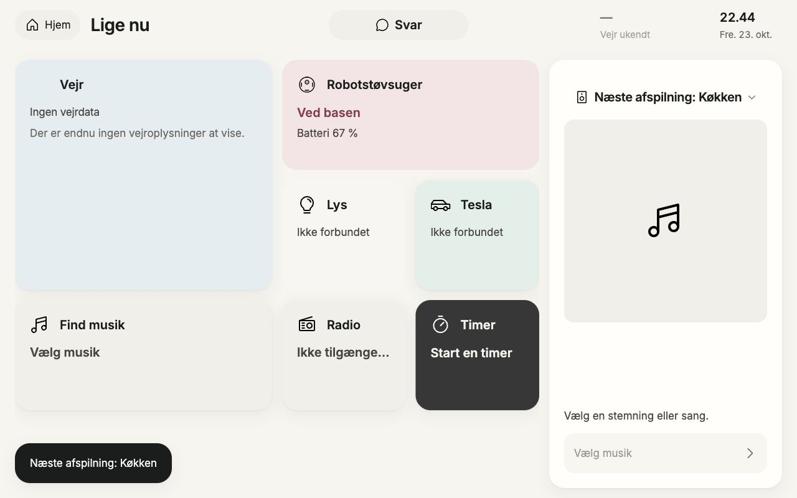

# Idle next-output label — silent native proof

23 October2026. Actual basic-speakers fixture emptyplayer, EMPTYtimers; native1280iframeclip withoutsharedviewportchange. Openoutput→actual3sread→clickofferedKøkken(startSelectabletrue), Svendavailable/startfalse andFridaunknownremaininert. Modalcloses; persistentplayerheading now “Næsteafspilning:Køkken”, while playerstayshonestlyempty. This is desirednextdestination only, notcurrentoutput or playback. ScreenshotshowsheadingseparatelyfromToast. NoPlay/effectPOST/audio. SamecanonicalSpeakerOutputView/Player owner; nofixtureauthoritychange. Personallyinspectedimage: targetfitsheader, icon/chevronreserved, unchangedcover/emptycopy.

Final source and image SHA-256 binding: LATE-SILENT-REVIEW-METADATA.json. Screenshots personally inspected using Product Design and Impeccable review criteria; source/tests, local visual evidence, provider delivery and physical acceptance remain separate.
