# Scoped lights — actual local browser review

23 October2026. Local authored protocol only; no household/HA/provider effects. Final bounded local software/visual PASS after canonical control-modal correction. First-pass findings below are historical; no physical or provider acceptance.

## Fixture and dimensions

scripts/lights-flow-fixture.mjs uses actual closed home area/placement/light and opaque native control schemas; five focused tests include actual GET/query-free POST response roots, TTL, changedsource, removedplacement, unknown/empty and forgedtargets. All effect endpoints reject; no external transport exists. Snapshot timers.items=[] throughout, no local timers/alarms/audio. Player honestly empty and unchanged through all room changes. CUA own Chrome tabs only; no user/HA tab or viewport edits. Product1280×800 actual iframe at0,0 inlarger browser; screenshots clip exactframe1280×800, not rescale product.

## Actual native flow

1. Actual ownKitchen home read: two entities, Loftlys on/128brightness/dimmer and Bordlampe off/contact. Home/overview caption 1af2. Open actualresource into Lys·Køkken detail.
2. Click Stue: explicit scoped /home?lightArea=living. One unknown Gulvlampe; “Lysstatus ukendt ·1ukendt”, Betjen disabled. Ownplacement staysKitchen in source; no own state mutation from detail browse.
3. Click Tomtrum: explicit empty scoped read, “Ingen lys i rummet”, no fake lamps, Betjen disabled.
4. Click Køkken: actual own2entities restored. Click Loftlys: passive native modal “Køkken·Loftlys”; switch/slider disabled, current50% and “Kun visning·Home Assistant”. No controlsetup on passive open.
5. Explicit Betjenlampe requests native setup for exactKitchen/dimmer only. Pending then admitted Tænd/Sluk/Lysstyrke offer. No command button or slider was changed/clicked. Actual15s observation TTL later auto-closes controls, retains honest “Sidst kendt:1af2tændt” and disables Betjen; no clock manipulation.

## First-pass Product Design / Impeccable findings

Saved images personally inspected. Own/other/empty maintain Hero top96, shared warm surface, roomChoiceList, retained lampframes and unchanged emptyplayer. Empty/unknown status honest, touch labels remain legible. Passive lamp modal centered fullframe and identifies selectedtarget; clear distinction between disabled read state and explicit Betjen.

Offered control modal is materially weaker: generic “Lys” loses selectedroom/lamp target; small Tænd/Sluk buttons stacked in large genericrows; duplicated Lysstyrke heading/label. Reported to root and actual LiveControlView owner for canonical correction. No local style/workaround added. These images are historical findings, not after-fix acceptance.

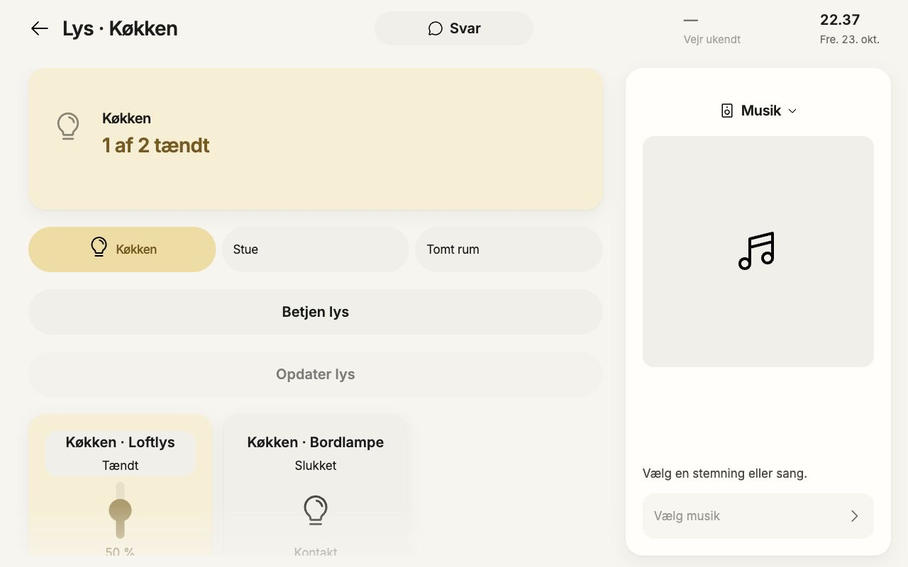

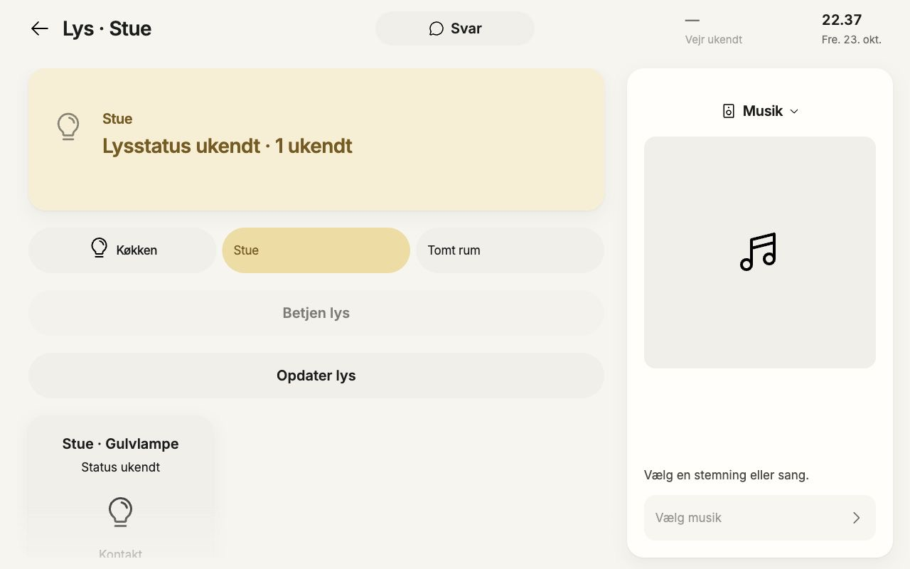

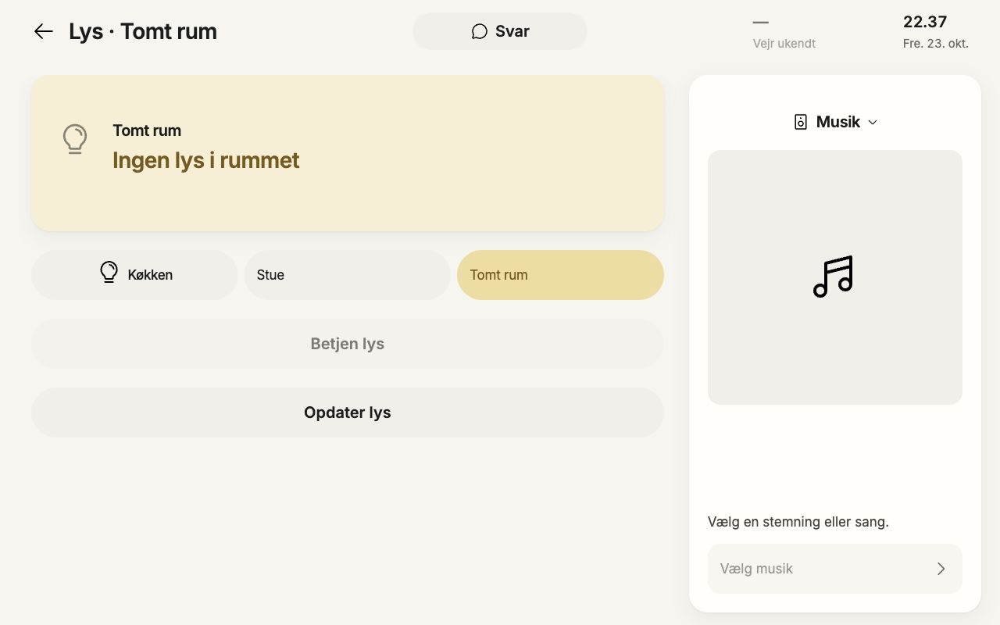

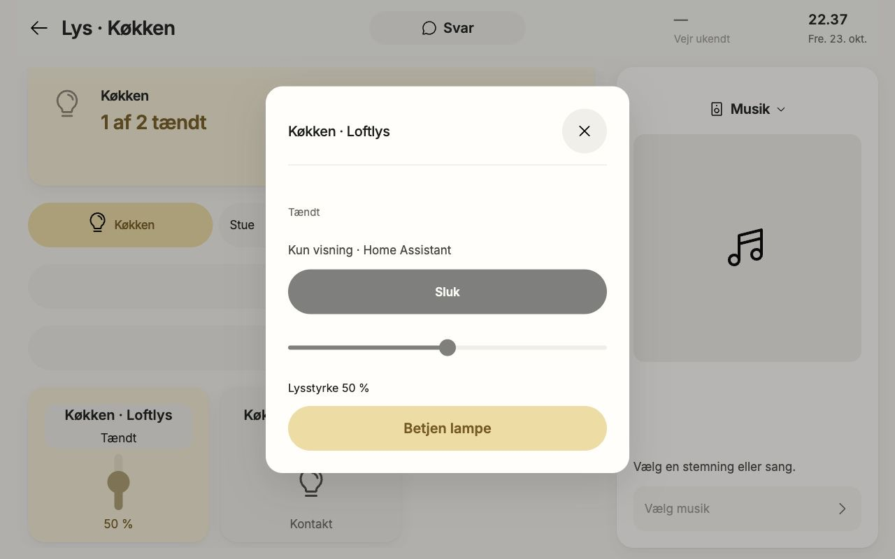

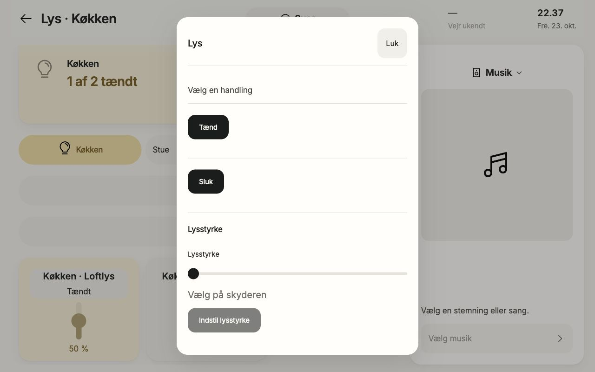

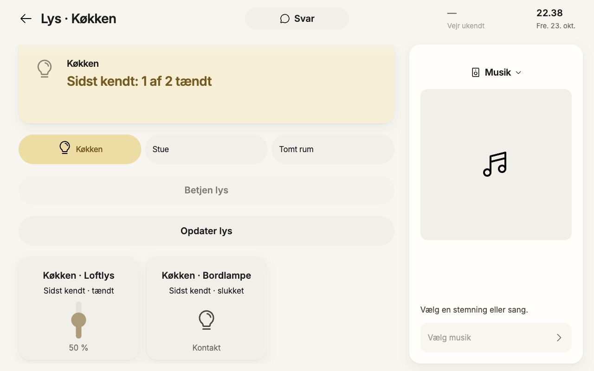

## Corrected final after-proof

Release owner rebuilt combinedsource, reported1990/1990tests+gatePASS, server75818. Reopened fresh observedKitchen/Loftlys passive modal then explicitBetjenlampe, waited for actualofferedTændbutton (no command click). Final title retains “Køkken·Loftlys”; Tænd/Sluk now fullwidth64pxsharedbuttons; one Lysstyrke label, reservedhelper “Vælg på skyderen” distinguishes unsentdraft0 from observed50%. No submit, sliderchange or effects. Correctedimage personally inspected: targetclear, fixedmodalpadding, controlscontained, no duplicatedheading or tinyactionbuttons. Passive observation remains disabled/read-only until offered nativecontrolsetup. The actualTTL still revokes expiredcontext; no staleadoption or clockmanipulation.

Library actual Lys/Rum·Køkkenet and its lampdialog compared using sharedHero/ChoiceList/Tile/Toggle/Slider/Dialog anatomy. These are authored localfixtures with different values/authority; native15ssource and controlsetup are proved ONLY in productfixture. Library images are2006×1038outer containing scaled1280preview, not native1280captures. Library has visible authoredWholeHome option; native area catalogue has only actualthreeareas and does not inherit it.

Existing robot library9room panel rechecked after sharedcontrolCSS: threecolumns retained, roomTiles and Start64px; secondarysettings retain their existing51.5pxrole. No robot actions. This is bounded regression comparison, not robotdeviceacceptance.

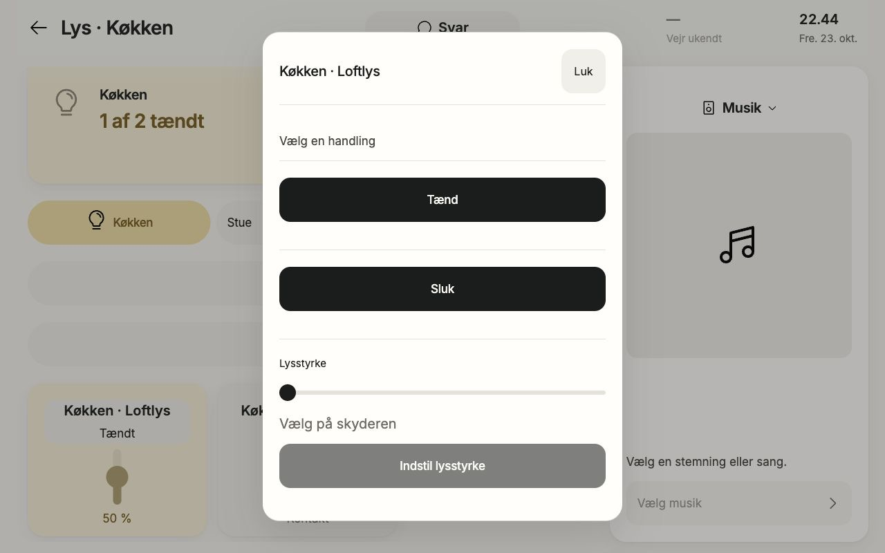

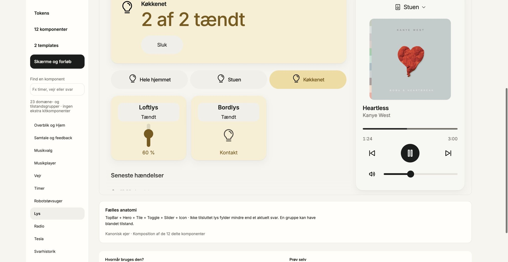

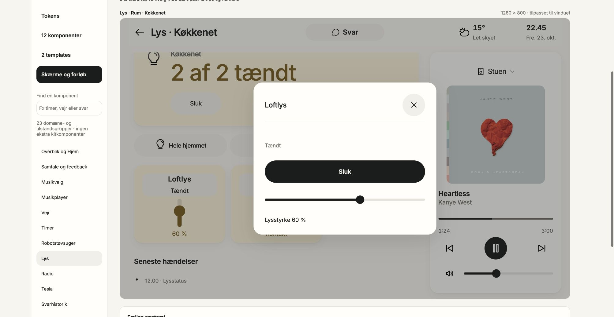

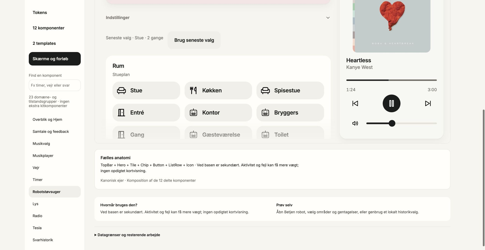

No HA/provider/audio/timer/action submissions. Emptytimercontext preserved. Sourcechanges/removal/unknown/TTL strictness additionally covered by focusedactualvalidators/wiretests; no claim that all such transitions were browserinjected or physical. Finalsourcehashes are recorded in LATE-SILENT-REVIEW-METADATA.json after finalcaptionbuild.

## Final mandatory modal geometry — PASS

After completed final3 build (release owner reports1993/1993 + component gate PASS), one clean native flow repeated only the corrected modal. Photo entry remained passive until the actual source arrived; opening the visible light resource then Loftlys → Betjen lampe produced the current offer. No command, slider or playback interaction.

Measured border box: x380,y38.5,width520,height723 in the actual1280×800 product iframe. CSS padding is exactly32px. Header/content left412 and top70.5 give exact32px horizontal/top insets; content width456. Tænd, Sluk and Indstil lysstyrke each456×64. Center is640,400, the full viewport center. Full geometry saved in LIGHTS-FINAL-MODAL-GEOMETRY.json. Saved final JPEG inspected visually: target and controls legible, balanced32px inset, full overlay, no clipping or overlap. Earlier lights-offered-final.jpg used24px and is superseded by this final32px proof.

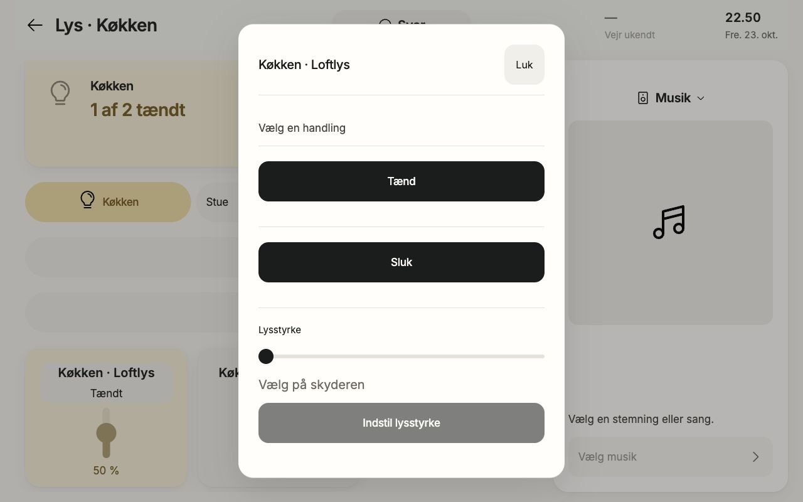

Own two QA tabs closed. No shared Chrome viewport changes, user/HA tab actions, timer starts, alarms, audio or physical effects. Root-owned fixture server remains running for release-owner cleanup.

Final source and image SHA-256 binding: LATE-SILENT-REVIEW-METADATA.json. Screenshots personally inspected using Product Design and Impeccable review criteria; source/tests, local visual evidence, provider delivery and physical acceptance remain separate.
